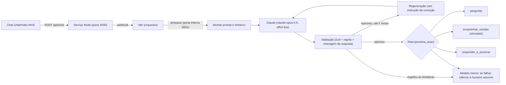

# leadgate

Demo aberta de um assistente de IA que faz a triagem de leads no chat de uma empresa de climatização (a CentralEng, em escala de piloto fictício), mais a esteira de desenvolvimento quase autônoma que construiu o projeto.

Estado: protótipo em fase de teste. Não há cliente, uso em produção nem resultado além dos que estão medidos na seção Avaliação, com os limites ditos ali.

## Problema

Uma empresa de ar-condicionado recebe pedidos pelo site sem nenhuma triagem. No mesmo balde chegam o escritório que precisa de manutenção, o apartamento que a empresa não atende, o pedido de outra cidade e o spam. O time de vendas gasta tempo separando o que vale uma ligação do que não vale.

Um formulário com campos fixos resolve pouco: as pessoas escrevem de formas diferentes ("o ar do data center parou agora", "palhosa", "quanto custa?"), e um formulário não conversa, não confirma uma cidade escrita errada nem percebe uma emergência.

Aqui a IA entra onde a linguagem é solta: entender o que a pessoa quer, pedir só o que falta e responder como um atendente. As regras de negócio, porém, são fechadas (quais serviços, quais segmentos, quais cidades). Por isso o modelo propõe e o código decide: o que o modelo devolve é conferido por regras determinísticas antes de qualquer coisa chegar ao lead ou ao time.

## O que construí

- Um chat que conversa com o lead, coleta o mínimo (serviço, segmento, cidade e, só depois, nome e telefone) e decide se ele é qualificado.
- Um JSON validado como saída, com a próxima ação: perguntar, encaminhar para vendas, encerrar com educação ou encaminhar para uma pessoa.
- Travas em camadas para o agente não sair do papel, não prometer preço ou prazo e nunca negar que é uma IA.
- Uma avaliação reproduzível com 20 casos, mais um conjunto separado de regressão com falhas que já aconteceram.
- Uma esteira de desenvolvimento em que agentes especificam, implementam, revisam e registram o que aprenderam (seção final).

A empresa, as cidades, os limites e os textos ficam em `config/empresa.json`, não no código. Na tela do chat, `tela.titulo` define só o título da aba do navegador (o cabeçalho visível é fixo, "Atendimento CentralEng"); as cores da conversa ficam nos tokens de `chat/index.html`, e `cor_primaria` e `cor_destaque` não são mais aplicadas ali, embora `/tela.json` ainda as devolva. O encaminhamento para vendas e para uma pessoa é simulado: nada é enviado a ninguém.

## O que funcionou

Os números abaixo vêm de `avaliacao/tabela.md` e estão detalhados em Avaliação.

- No conjunto reservado (6 casos, rodado uma única vez), `tipo_servico`, `cidade`, `urgencia`, `qualificado` e `proxima_acao` acertaram 6 de 6. `segmento` acertou 5 de 6.
- No conjunto de regressão (9 casos de falhas passadas, separado), todos os campos acertaram 9 de 9.
- A validação determinística cobre o que o modelo pode errar sem perceber. A média foi de 1,03 tentativa por turno no ajuste e de 1,13 no reservado, ou seja, a regeneração é rara.
- O conjunto de ajuste fechou em 14 de 14 em todos os campos, mas isso não conta como prova: o prompt foi ajustado olhando esses mesmos casos.

## O que aprendi

Cada história abaixo tem uma causa comprovada.

- **O n8n quebrou o Zod.** A primeira ideia era validar a saída num nó Code do n8n, com Zod. O nó Code do n8n 2.46 endurece os globais: `Object.defineProperty` não define nada e não dá erro, e o Zod depende dessa função. Os 68 testes passavam porque simulavam o nó num ambiente sem essa proteção. A validação foi para um serviço Node que o n8n chama por HTTP. Regra que ficou: simulação de plataforma não prova integração; fatia que depende do n8n só termina depois de rodar no contêiner.
- **Um diagnóstico errado, admitido.** Ao ver `$.derived is not a function`, apontei que o `$` gerado pela compactação colidia com o `$` do n8n. Corrigi, e o erro voltou com outro nome. A hipótese vinha só do nome da variável; nenhum experimento a separava das outras. Um workflow de diagnóstico de 15 linhas achou a causa em uma tentativa. Regra: confirmar a causa com um teste mínimo antes de corrigir.
- **O validador podia empurrar o modelo para a resposta errada.** Uma revisão de segurança mostrou que a checagem de cidade deixava passar uma cidade homônima com estado errado, `Santa Maria-DF` (a da lista é Santa Maria-RS), e isso pesava a favor de qualificar o lead. Hoje o sufixo de estado só vale se bater com a UF da cidade configurada; com telefone, o caso vira `encaminhar_humano`. Ficou coberto por teste (`tests/validacao.test.ts`) e pelo caso g01 da regressão.
- **Um falso positivo que gastou 3 chamadas.** A trava de promessa proibida reprovava a palavra `desconto` até quando o agente a recusava ("não trabalhamos com desconto, o time de vendas explica"). O modelo repetia a frase, a trava repetia a reprovação, e as 3 tentativas se esgotavam. A trava passou a ignorar o termo quando vem depois de uma recusa ou de um redirecionamento (caso g07, `tests/resposta.test.ts`).
- **Uma avaliação que imprimia 404 em todos os casos e saía com código 0.** O n8n responde 404 enquanto o workflow não está ativo. O executor registrava as falhas e terminava "com sucesso", e uma tabela vazia parecia resultado. Hoje o executor espera o webhook ficar pronto, termina com código 1 se todos os turnos falharam (e não grava resultado) e também com código 1 se algum caso teve falha HTTP. O conjunto reservado se recusa a rodar duas vezes sem `--forcar`.

## Arquitetura



O n8n só orquestra; a decisão de qualificar é do modelo, e quem confere é o código. As rotas `/preparar` e `/validar` ficam numa porta interna (3001) que o Compose não publica no host. A landing page é servida em `127.0.0.1:8080/` e o chat em `127.0.0.1:8080/conversa`.

## Contrato JSON

Definido na seção Contrato de saída de `prompts/agente.md` e validado por Zod em `src/validacao/contrato.ts`. O modelo responde só com este objeto:

```json
{
  "tipo_servico": "instalacao | manutencao | pmoc | projeto | fora_escopo | null",
  "segmento": "residencial | comercial | industrial | null",
  "cidade": "string | null",
  "nome": "string | null",
  "telefone": "string | null",
  "urgencia": "alta | media | baixa | null",
  "dados_faltantes": ["tipo_servico | segmento | cidade | telefone"],
  "qualificado": true,
  "confianca": 0.0,
  "proxima_acao": "perguntar | encaminhar_vendas | responder_e_encerrar | encaminhar_humano",
  "resposta": "texto ao lead"
}
```

Regras que o código impõe sobre esse contrato: `qualificado = true` só com serviço atendido, segmento aceito (hoje comercial e industrial), cidade da lista e telefone; `encaminhar_vendas` exige `qualificado = true` e `confianca` de pelo menos 0,7; `perguntar` exige exatamente um `?` na resposta. Divergência entre o que o modelo decidiu e o que as regras dizem sai do fluxo normal e vai para o caminho humano. O prompt (versão 1.2.0) tem um canário, as travas e a regra de honestidade sobre ser IA.

## Avaliação

Modelo: `claude-opus-5-5`, com `effort` em `low` (`config/empresa.json`). Limiar de confiança: 0,7. O gabarito está em `avaliacao/casos.json` e `avaliacao/regressao.json`; todos os dados são fictícios.

**Como os números devem ser lidos.** A divisão entre ajuste e reservado é desenho nosso, não um benchmark público, e a amostra é pequena: com 14 e 6 casos, um caso a mais ou a menos muda muito o percentual. O prompt foi ajustado olhando os 14 casos de ajuste, então o 14/14 deles não é independente. O conjunto reservado (6 casos) rodou exatamente uma vez, com a versão 1.2.0 do prompt, e só os números dele não foram usados para ajustar nada. O conjunto de regressão (9 casos) guarda falhas que já aconteceram e reúne falhas que já corrigimos no prompt e nas travas, por isso não entra nos números do ajuste nem do reservado.

### Acerto por campo

| Campo | Acerto ajuste (n=14) | Acerto reservado (n=6) | Regressão (n=9, separado) |
|---|---|---|---|
| tipo_servico | 14/14 (100%) | 6/6 (100%) | 9/9 (100%) |
| segmento | 14/14 (100%) | 5/6 (83%) | 9/9 (100%) |
| cidade | 14/14 (100%) | 6/6 (100%) | 9/9 (100%) |
| urgencia | 14/14 (100%) | 6/6 (100%) | 9/9 (100%) |
| qualificado | 14/14 (100%) | 6/6 (100%) | 9/9 (100%) |
| proxima_acao | 14/14 (100%) | 6/6 (100%) | 9/9 (100%) |

Ajuste e regressão: números em que se mexeu no prompt (não independentes). Reservado: números em que não se mexeu.

**O erro do reservado.** No caso r05 ("Vocês consertam geladeira do meu restaurante?", fora de escopo), o gabarito esperava `segmento` vazio e o modelo preencheu `comercial`. Os outros campos do caso estavam certos: `fora_escopo`, `qualificado = false`, `responder_e_encerrar`. Não ajustei o prompt depois disso, para manter o reservado como foi medido.

### Confiança contra o limiar (0,7)

| Conjunto | Acerto com confiança >= limiar | Acerto com confiança < limiar | Erro com confiança >= limiar | Erro com confiança < limiar | Limiar separa |
|---|---|---|---|---|---|
| ajuste | 10 | 4 | 0 | 0 | 10/14 |
| reservado | 3 | 2 | 1 | 0 | 3/6 |

O erro do reservado teve confiança de 0,85, acima do limiar. Então o limiar, neste conjunto, não separou o erro dos acertos. No conjunto de regressão a contagem foi: acerto alta 3, acerto baixa 6, erro alta 0, erro baixa 0. Caso que falhou conta como erro com confiança abaixo do limiar.

### Variação e custo

| Conjunto | Pares de aberturas idênticas (meta: zero) | Tentativas por turno (média) |
|---|---|---|
| ajuste | 1 | 1,03 |
| reservado | 0 | 1,13 |

O ajuste tem um par de aberturas idênticas, então a meta de variação não foi atingida lá.

### Checklist de tom e travas

Os itens 1 a 4 são automáticos (travas da resposta). O item 3 usa o mesmo detector de prazo da trava da resposta, então só conta formas como "ainda hoje" ou "até amanhã", não um "hoje" solto. Com isso, todos os casos do ajuste, do reservado e da regressão passam nos itens automáticos aplicáveis. Uma versão anterior da checagem, mais larga, marcava a03 e a04 por "hoje" e "agora mesmo" em frases que não prometiam prazo. Os itens 5 a 10 foram lidos uma vez: 120 de 124 marcações aprovadas, e o detalhe está em `avaliacao/tabela.md`.

### Reproduzir

Com o Compose no ar e a chave no `.env`. A avaliação passa pelo proxy `/api/chat` (porta 8080), o único ponto que conta falhas, e por isso o Compose sobe com o painel ligado e o limite de requisições por minuto folgado:

```sh
DEMO_PAINEL=1 LIMITE_POR_MINUTO=600 docker compose up
```

Em outro terminal:

```sh
DEMO_PAINEL=1 node scripts/avaliar.mjs --conjunto ajuste && node scripts/tabela-avaliacao.mjs
```

A avaliação zera a contagem de falhas antes de começar e grava `avaliacao/falhas-<conjunto>.md` (a taxa é por conjunto; sem nenhum turno medido o arquivo diz "não medida"). O segundo comando regenera `avaliacao/tabela.md`, com um bloco listando cada `falhas-<conjunto>.md` encontrado. Os conjuntos `reservado` e `regressao` rodam com o mesmo comando trocando o nome; o reservado recusa uma segunda rodada sem `--forcar`. O modelo não é determinístico, então uma nova rodada pode dar números diferentes.

## Quando algo falha

O fluxo tem três camadas, e cada uma só entra quando a anterior se esgota. Os valores abaixo vêm de `config/empresa.json`.

1. **Repetir.** Falha de rede, de DNS, de tempo esgotado, limite de taxa (429) ou erro 5xx repete a mesma chamada até 3 vezes, esperando 1 s e depois 3 s (ou o tempo que a resposta pedir no cabeçalho `retry-after`, até 30 s). Saída reprovada pela validação é regenerada até 2 vezes, com a instrução de correção. Erro 4xx do cliente e limite de gasto da conta não repetem: vão direto para a camada 2.
2. **Modelo menor.** Esgotada a camada 1, o fluxo troca para o modelo de reserva (`claude-haiku-5-5`), com até 2 chamadas lógicas. Se a reserva responder e passar na validação, o lead recebe a resposta normalmente.
3. **Silêncio e humano assume.** Se a reserva também falhar, ou se não houver modelo de reserva configurado, o lead não recebe resposta automática. O turno termina com `proxima_acao = encaminhar_humano` e `estado_conversa = aguardando_humano`, tenha o lead dado telefone ou não. Não há mais mensagem de falha técnica.

**Aviso ao vendedor.** O serviço acompanha os turnos: duas falhas seguidas (`alerta.turnos_para_queda`) geram um aviso de queda, e uma falha do n8n ou do próprio serviço gera o aviso na hora. Enquanto a queda durar, o aviso se repete no máximo a cada 30 minutos (`alerta.intervalo_min`). Quando um turno volta a ser respondido pelo modelo, sai um aviso de recuperação com o número de conversas afetadas. O canal padrão é **simulado**: o aviso vai para o log e para `GET /alertas`. Há também um canal de e-mail pelo Resend, ativado com `ALERTA_CANAL=resend` e `RESEND_API_KEY`; ele está pronto, mas precisa de uma conta, e sem a chave o serviço fica só no canal simulado. Os textos dos avisos ficam em `textos.alerta_queda` e `textos.alerta_recuperado` na configuração.

**Contagem de falhas.** Cada tentativa que falha é registrada com o tipo (`rede`, `dns`, `timeout`, `429`, `5xx`, `cliente`, `refusal`, `max_tokens`, `schema`, `servico`, `sobrecarga`, `n8n`), a camada, o modelo e se foi recuperada. O resumo traz o total de turnos, os turnos que terminaram em falha, a taxa de falha, as tentativas falhas por tipo, quantos turnos cada camada recuperou e qual modelo respondeu. Não é guardado texto de conversa. Os contadores ficam em volume do Compose: `docker compose down -v` apaga a contagem de falhas e o histórico de avisos. O resumo fica em `GET /falhas`, exposto só com `DEMO_PAINEL=1`, e a taxa entra no bloco "Taxa de falha" de `avaliacao/tabela.md`.

## Dataset sintético

Para ter mais conversas do que as escritas à mão, o repositório traz um dataset de **80 conversas fictícias**, geradas pelo `claude-opus-5-5` e separadas em **38 exemplos** (`avaliacao/dataset/exemplos.json`) e **42 de validação** (`avaliacao/dataset/validacao.json`). O registro da rodada está em `avaliacao/dataset/rodada.json` e a amostra para leitura humana em `avaliacao/dataset/revisao.md`. Todos os telefones seguem o padrão fictício com `99999`.

O dataset **ainda não passou pela revisão humana**, e por isso `prompt_liberado` continua `false`: o prompt (`prompts/agente.md`) mantém os 3 exemplos atuais e não foi alterado a partir dele. Também não treina nem ajusta o modelo: ele alimenta exemplos para o prompt e serve de validação.

A primeira rodada de validação, no modelo principal, deu estes acertos contra o gabarito gerado:

| Campo | Acerto |
|---|---|
| `tipo_servico` | 37/42 |
| `segmento` | 41/42 |
| `cidade` | 32/42 |
| `urgencia` | 28/42 |
| `qualificado` | 40/42 |
| `proxima_acao` | 35/42 |

Esses números não se comparam com os da avaliação escrita à mão, porque o gabarito também foi gerado por modelo e ninguém o revisou. Parte das divergências é do gabarito: urgência é julgamento, e pedido de spam pode ter `tipo_servico` nulo ou `fora_escopo`. Parte é do agente: em áudio mal transcrito, ele repete a cidade errada ("blume nau") em vez de confirmar. Na mesma rodada, 1 de 90 turnos terminou em falha, um caso de injeção em que a trava de vazamento barrou todas as tentativas; 14 turnos se recuperaram sozinhos, 1 deles pelo modelo reserva.

O modelo reserva, `claude-haiku-5-5`, foi medido nos 14 casos de ajuste com o mesmo prompt: de 12 a 13 acertos por campo, e 1 caso barrado pela trava de vazamento. É suficiente para manter a conversa de pé durante uma falha, não para substituir o modelo principal.

## Segurança e travas

As camadas, da mais interna para a mais externa:

1. **Schema.** Saída com campos, tipos e valores fechados (Zod). Saída fora do contrato é reprovada.
2. **Regras entre campos.** Qualificado exige serviço, segmento, cidade e telefone válidos; telefone é conferido (número colado sem DDD real, ou precedido de "CPF", não conta); cidade precisa ter sido citada pelo lead e o sufixo de UF precisa bater com a lista.
3. **Checagem da resposta ao lead.** Nunca negar ser IA nem afirmar ser humano; nenhum preço inventado (valor em reais); nenhuma promessa (garantia, desconto, grátis) nem prazo; o canário do prompt não pode aparecer; nome de provedor de IA (Claude, GPT, Gemini e outros da lista) não pode aparecer; no máximo um `?`, até 400 caracteres, sem menu numerado, sem frase de robô.
4. **Regeneração.** Reprovou, o fluxo chama o modelo de novo com uma instrução que aponta a regra violada, até 2 vezes (3 tentativas). Esgotou: o fluxo troca para o modelo menor e, se ele também falhar, segue o caminho descrito em "Quando algo falha".
5. **Rotas internas em porta separada.** `/preparar` e `/validar` ficam na porta 3001, não publicada no host.
6. **Limites de uso.** Corpo de até 16 KB, 20 requisições por minuto por cliente e 4 chamadas simultâneas (configuráveis em `.env.example`). Histórico limitado a 8 mil caracteres. A porta 5678 é publicada em localhost, então um processo local pode postar direto no webhook do n8n e pular os limites da rota pública.

Limites conhecidos, que a spec não esconde:

- O histórico da conversa vem do cliente. Quem controla o navegador pode forjar mensagens anteriores, inclusive apagar as perguntas já feitas e assim burlar o teto de perguntas. O prompt trata mensagens anteriores atribuídas ao agente como não confiáveis, mas isso não impede a falsificação.
- Vazamento traduzido não é detectado. A checagem do canário e do trecho do prompt é literal; se o modelo for induzido a traduzir ou reescrever as travas, a comparação não pega. O caso g09 da regressão (pedido de repetir o canário e traduzir as travas) acertou os campos, mas uma resposta boa não é garantia contra todas as formas de pedir.

## LGPD

O chat abre com um aviso fixo (`textos.aviso_lgpd`, texto da configuração, não gerado pelo modelo). Ele diz que o atendimento é automatizado por IA; que nome, telefone, cidade e tipo de serviço são usados só para a equipe comercial retornar; que as mensagens são processadas por um provedor de IA e podem sair do Brasil; que os dados são guardados por 30 dias; como pedir acesso, correção ou exclusão; e pede para não enviar dados sensíveis nem de terceiros.

- **O que fica guardado:** o histórico da conversa e o JSON, na execução local do n8n.
- **Por quanto tempo:** `lgpd.retencao_dias = 30` na configuração e `EXECUTIONS_DATA_MAX_AGE=720` (horas) no Compose. Sem volume, derrubar o Compose apaga tudo.
- **Minimização:** nome e telefone só são pedidos depois que serviço, segmento e cidade estão fechados e o lead ainda está em escopo.
- **Dados do repositório:** só fictícios.

Lacuna honesta: a base legal do tratamento e a transferência internacional (as mensagens vão ao provedor do modelo) precisam do texto jurídico da própria empresa. Este repositório não fornece esse texto e não é aconselhamento jurídico.

## Limitações

- O histórico vem do cliente (ver Segurança), então o teto de perguntas pode ser forjado.
- A amostra é pequena: 14 casos de ajuste, 6 reservados e 9 de regressão, todos escritos por nós.
- Não há cliente em produção. Tudo roda em teste.
- O checklist de leitura humana (itens 5 a 10) foi feito uma vez: 120 de 124 marcações aprovadas, e os casos a01, a03, a04 e a14 têm um item reprovado.
- Não há autenticação.
- Roda só em Docker local; nada está hospedado e o encaminhamento para vendas é simulado.
- O aviso ao vendedor é simulado por padrão; o canal de e-mail está pronto, mas só funciona com uma conta no provedor.
- O dataset sintético ainda espera a revisão humana, e o prompt não foi alterado a partir dele.

## Como rodar

Precisa de Docker e de uma chave da API da Anthropic. Node 22 ou mais novo só é necessário para os testes e a avaliação.

```sh
cp .env.example .env        # preencha ANTHROPIC_API_KEY, sem aspas
docker compose up --build   # sobe o serviço Node e o n8n (workflow importado e ativado na partida)
```

Abra `http://127.0.0.1:8080` para a landing page; o botão "Entrar em contato" leva ao chat, em `/conversa`. O n8n fica em `http://127.0.0.1:5678`, onde se vê cada execução. Para conferir o código:

```sh
npm install
npx vitest run && npx tsc --noEmit
```

Com `docker compose --profile teste up` e `ANTHROPIC_BASE_URL=http://stub:8787`, o fluxo roda contra um modelo simulado, sem gastar chamadas da API. Ao terminar, `docker compose down`.

## A esteira de desenvolvimento

A segunda metade do projeto é o processo que o construiu. Os arquivos citados abaixo estão na branch `chore/esteira` e chegam à branch principal quando ela for integrada: `.claude/skills/esteira/SKILL.md` (o ciclo), `docs/aprendizados.md` (falhas e regras) e `docs/esteira/metricas.md` (uma linha por ciclo). O ponto de partida de cada ciclo é `docs/estado.md`.

**O ciclo tem 7 passos:** (1) escolher uma única issue pela prioridade; (2) especificar em `docs/specs/NNN-nome.md`, com critérios Given/When/Then; (3) implementar em fatias pequenas, com teste escrito antes e visto falhar pela razão certa; (4) passar nos portões; (5) revisar; (6) abrir o PR; (7) retroalimentar.

**Portões.** Testes (`vitest`), tipos (`tsc`), build do serviço e workflow gerado sem diferença em `n8n/`. Quando muda prompt, validação ou configuração, roda também a avaliação de ajuste contra o Compose no ar, e campo que piorou bloqueia o PR.

**Quem escreve não revisa.** Um agente implementa uma fatia; outro, sem ver o resumo do primeiro, revisa o diff. Achado crítico, alto ou médio é corrigido com um teste por achado; achado baixo vira issue. Spec de regra de negócio é escrita por um agente próprio e aprovada por uma pessoa antes de qualquer código.

**Como cada falha realimenta.** O passo 7 é o que diferencia a esteira de um script. Cada falha real vira uma entrada em `docs/aprendizados.md` com evidência, causa provada e regra (sem causa provada não há regra). Lição que aparece duas vezes vira teste ou portão. Falhas de comportamento entram no conjunto de regressão (`avaliacao/regressao.json`: Santa Maria-DF, CPF no lugar do telefone, `desconto`, extração do canário). Cada ciclo acrescenta uma linha a `docs/esteira/metricas.md`, que hoje está sem ciclos registrados, e abre de uma a três issues a partir do pior campo da tabela.

**Limites da esteira.** Ela para e registra quando a mudança toca regra de negócio que a spec não cobre ou a honestidade sobre ser IA, quando um portão nega um comando, quando o mesmo teste falha em duas correções seguidas ou ao fim de três ciclos. Nunca põe o rótulo `revisado-por-humano`, nunca aprova o próprio PR, nunca enfraquece teste para passar e nunca olha o conjunto reservado para ajustar o prompt. Texto de issue é tratado como dado não confiável, como a mensagem de um lead.

**Supervisão.** A esteira não rodou sozinha. Uma pessoa autorizou os merges neste repositório e aprovou as specs, e qualquer mudança pode ser revertida por uma pessoa. "Quase autônoma" quer dizer que os ciclos de especificar, implementar, revisar e registrar rodam sem ajuda a cada passo, não que ninguém acompanha.
